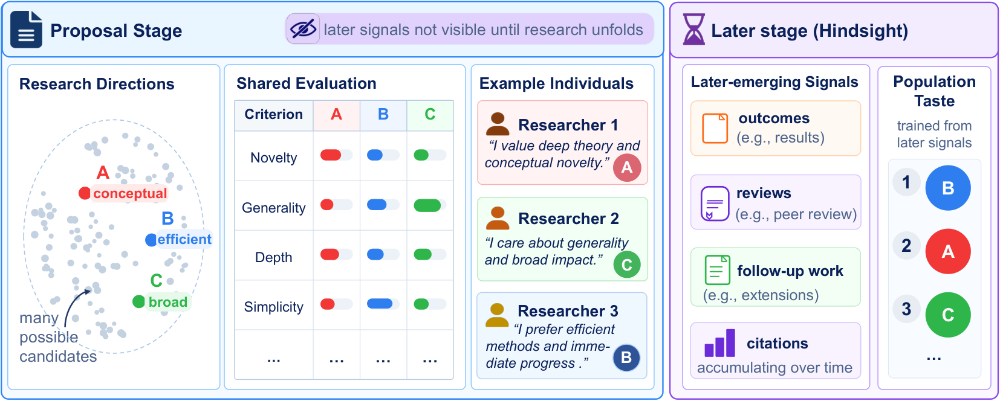
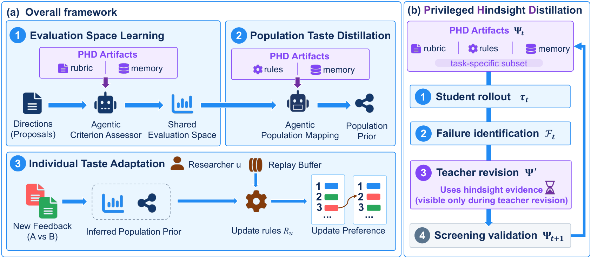

Which research direction is worth pursuing? Researchers may agree on a proposal's novelty or technical depth and still choose different directions. Our new paper, **Learning Individual Scientific Taste with Privileged Hindsight Distillation**, studies how AI can learn these individual preferences from a small number of comparisons.

<!--more-->

## From Shared Assessments to Individual Preferences

We model scientific taste as the way a researcher translates criterion-level assessments and their supporting evidence into relative preferences. Research directions share a six-dimensional evaluation space: generality, novelty, importance, parsimony, depth, and algorithmic complexity. Each researcher can then apply different weights and context-dependent rules to the same representation.

*Scientific taste as a mapping from shared assessments to personal preferences. Source: Figure 1 of the [paper](https://arxiv.org/html/2610.19719v1#S1.F1).*

## Learning from Hindsight, Deciding at Proposal Time

**Privileged Hindsight Distillation (PHD)** uses completed research and later scientific evidence during training to diagnose mistakes in proposal-stage judgment. With the backbone model frozen, a teacher revises external scoring rubrics, conditional rules, and memory. Candidate revisions pass leakage screening and held-out validation before acceptance. At inference, the system uses only proposal-visible information and the accepted artifacts.

The framework first learns shared assessments and a population preference mapping, then adapts that mapping through researcher feedback. Personalization combines criterion reweighting with researcher-specific rules, checked against earlier feedback through cross-fitted replay.

*Shared assessment, population learning, and individual adaptation. Source: Figure 2 of the [paper](https://arxiv.org/html/2610.19719v1#S3.F2).*

## What the Experiments Show

In quantum research, seven researchers each provide 15 support comparisons and 10 held-out query pairs. The complete method achieves **0.693 RW-SP**, compared with **0.481** for Profile Prompting and **0.642** for FSPO (Table 1). RW-SP weights comparisons by researcher confidence and requires correct predictions under both presentation orders.

The population prior is already strong: its real-researcher score is 0.680, and criterion reweighting alone gives 0.679. Adding personal rules raises this to 0.693 (Table 4). Personalization therefore produces a modest aggregate gain over the prior, with examples showing recovery of opposing preferences over identical proposal pairs.

A separate interactive study with 20 researchers reports greater engagement than a matched Single Call baseline: a **0.684 win rate among non-tied competitive pairs** (Table 3). Engagement measures inspection, refinement, and adoption of proposals; it does not establish long-term scientific impact.

## Implications for Research Assistants

For AI-assisted research, learning which suggestions a researcher finds worth exploring could help guide attention as candidate generation becomes cheaper. An explicit preference mapping also creates something researchers can inspect and revise as their interests evolve.

The present evidence remains limited by the small real-expert cohort and fixed evaluation criteria. Shared-component reference labels are LLM-generated, and the study does not control knowledge already present in pretrained models. Broader expert studies and longer follow-up will be needed to assess how well learned taste supports sustained research.

**Paper:** [Learning Individual Scientific Taste with Privileged Hindsight Distillation](https://arxiv.org/abs/2610.19719) · [PDF](https://arxiv.org/pdf/2610.19719)

**Authors:** Hanwei Fan, Yanqiao Wang, Yiqi Zhu, Xuanyu Lei, Peng Li, Yang Liu.

*Based on the arXiv v1 preprint, submitted on October 14, 2026.*
